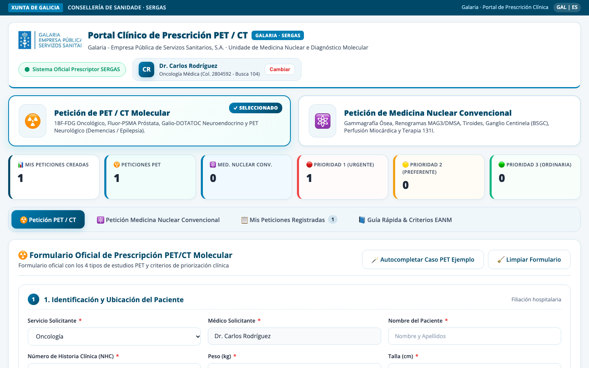
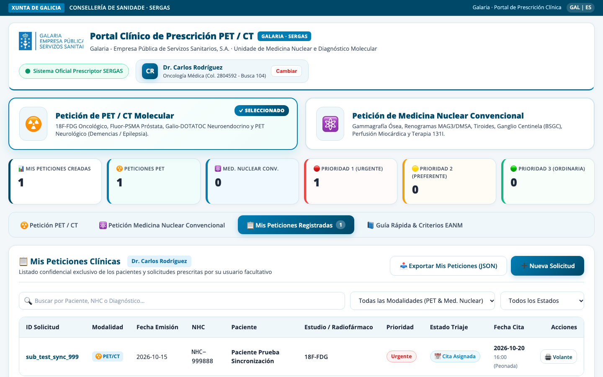
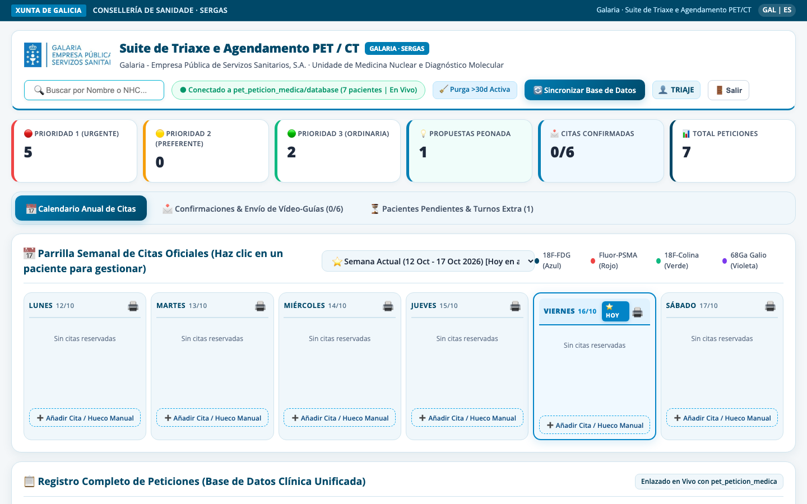
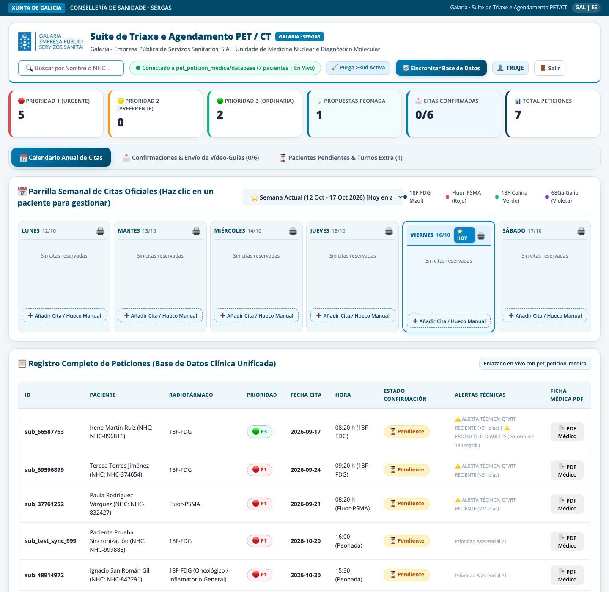
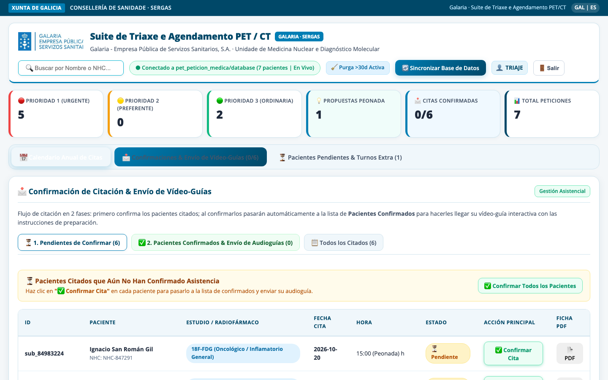
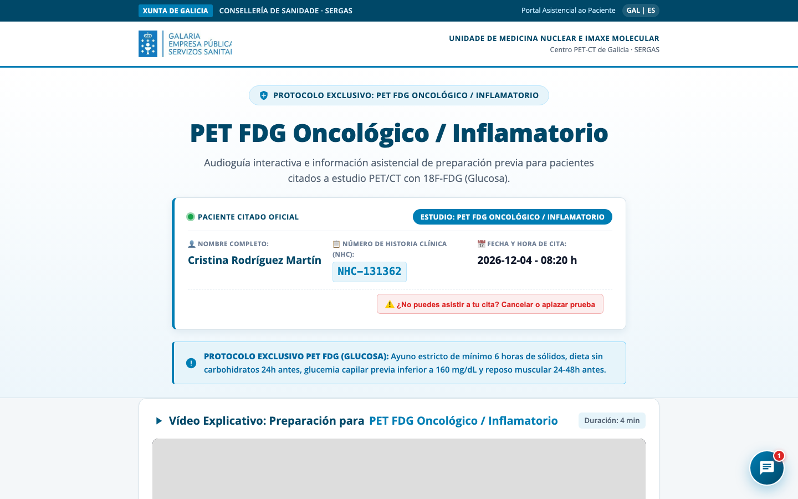
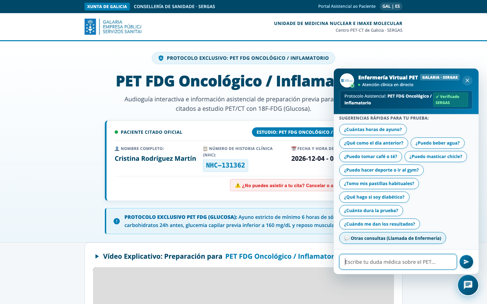
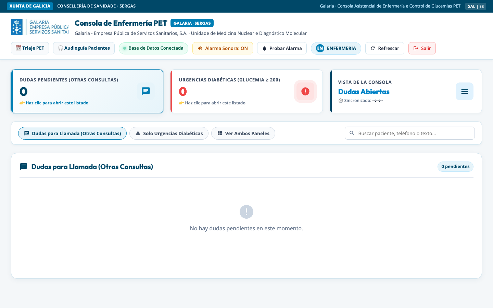

# 🏥 Ecosistema Digital PET/CT & Medicina Nuclear
## Manual Integral de Arquitectura Asistencial, Algorítmica y Guía Operativa
**Galaria · Empresa Pública de Servizos Sanitarios | SERGAS (Servizo Galego de Saúde)**  
*Documento Técnico, Clínico y de Gestión Asistencial · Edición Oficial Octubre 2026*

---

## 📌 Índice de Contenidos
1. [Visión Global del Ecosistema y Trabajo en Conjunto](#1-visión-global-del-ecosistema-y-trabajo-en-conjunto)
   - [El Problema Tradicional en los Servicios de Medicina Nuclear](#11-el-problema-tradicional-en-los-servicios-de-medicina-nuclear)
   - [Arquitectura de Interoperabilidad End-to-End](#12-arquitectura-de-interoperabilidad-end-to-end)
   - [Matriz de Beneficios Cuantitativos y Cualitativos](#13-matriz-de-beneficios-cuantitativos-y-cualitativos)
2. [Programa 1: Portal Clínico de Prescripción Médica](#2-programa-1-portal-clínico-de-prescripción-médica-pet_peticion_medica)
   - [Filiación Hospitalaria y Parámetros Dosimétricos](#21-filiación-hospitalaria-y-parámetros-dosimétricos)
   - [Catálogo Oficial de 10 Trazadores y Protocolos Clínicos](#22-catálogo-oficial-de-10-trazadores-y-protocolos-clínicos)
   - [Cuestionario Clínico Preventivo y Filtros de Seguridad](#23-cuestionario-clínico-preventivo-y-filtros-de-seguridad)
   - [Cálculo Dinámico de Prioridad en Tiempo Real](#24-cálculo-dinámico-de-prioridad-en-tiempo-real)
   - [Panel "Mis Peticiones Registradas": Auditoría y Visor del Médico](#25-panel-mis-peticiones-registradas-auditoría-y-visor-del-médico)
3. [Programa 2: Suite de Triaje Clínico y Agendamiento Matricial](#3-programa-2-suite-de-triaje-clínico-y-agendamiento-matricial-pet_ct_triage)
   - [Algoritmo de Priorización Clínica EANM / SERGAS](#31-algoritmo-de-priorización-clínica-eanm--sergas)
   - [Parrilla Semanal y Matriz Logística por Radiofármaco](#32-parrilla-semanal-y-matriz-logística-por-radiofármaco)
   - [Alertas Técnicas y Reglas de Bloqueo de Seguridad](#33-alertas-técnicas-y-reglas-de-bloqueo-de-seguridad)
   - [Gestión de Peonadas y Jornadas Extraordinarias](#34-gestión-de-peonadas-y-jornadas-extraordinarias)
   - [Flujo de Confirmación de Pacientes y Envío de Audioguías](#35-flujo-de-confirmación-de-pacientes-y-envío-de-audioguías)
4. [Programa 3: Portal de Audioguías y Preparación del Paciente](#4-programa-3-portal-de-audioguías-y-preparación-del-paciente-pet_prep_page)
   - [Audioguía Interactiva con Síntesis de Voz](#41-audioguía-interactiva-con-síntesis-de-voz)
   - [Cronómetro de Ayuno y Protocolo Dietético Restrictivo](#42-cronómetro-de-ayuno-y-protocolo-dietético-restrictivo)
   - [Protocolo Específico de Glucemia en Pacientes Diabéticos](#43-protocolo-específico-de-glucemia-en-pacientes-diabéticos)
   - [Chatbot Enfermero Virtual 24/7](#44-chatbot-enfermero-virtual-247)
   - [Sistema de Cancelación y Aplazamiento Online](#45-sistema-de-cancelación-y-aplazamiento-online)
5. [Programa 4: Consola de Enfermería y Control Pre-Analítico](#5-programa-4-consola-de-enfermería-y-control-pre-analítico-enfermeriahtml)
   - [Monitorización Asistencial Previa](#51-monitorización-asistencial-previa)
   - [Gestión de Urgencias Diabéticas (Glucemia ≥ 200 mg/dL)](#52-gestión-de-urgencias-diabéticas-glucemia--200-mgdl)
   - [Bandeja de Dudas y Solicitudes de Llamada](#53-bandeja-de-dudas-y-solicitudes-de-llamada)
   - [Impacto en la Reducción del Absentismo](#54-impacto-en-la-reducción-del-absentismo)
6. [Conclusiones y Hoja de Ruta Asistencial](#6-conclusiones-y-hoja-de-ruta-asistencial)

---

# 1. Visión Global del Ecosistema y Trabajo en Conjunto

## 1.1. El Problema Tradicional en los Servicios de Medicina Nuclear
Históricamente, los centros de Medicina Nuclear y Tomografía por Emisión de Positrones (PET/CT) han enfrentado tres cuellos de botella críticos:
1. **Peticiones en papel o formularios no normalizados:** Letra manuscrita difícilmente legible, omisión de datos antropométricos clave (peso, talla) imprescindibles para la dosimetría radiactiva, y falta de información terapéutica reciente (quimioterapia o radioterapia).
2. **Logística compleja y vida media ultracorta:** Los radiofármacos emisores de positrones (como el Flúor-18 con $T_{1/2} \approx 109.7$ min o el Galio-68 con $T_{1/2} \approx 67.7$ min) sufren decaimiento continuo desde su síntesis en el ciclotrón. Citar a un paciente sin una parrilla adaptada al radiofármaco genera pérdidas de miles de euros en dosis decaídas e inservibles.
3. **Cancelaciones en el día de la cita por mala preparación:** Un paciente que ingiere alimentos azucarados, mastica chicle o presenta glucemias elevadas (> 180 mg/dL) debe ser cancelado inmediatamente en la sala de inyección, perdiéndose la dosis encargada para él y retrasando su tratamiento oncológico.

## 1.2. Arquitectura de Interoperabilidad End-to-End
Para dar respuesta definitiva a estos retos, la Unidad de Medicina Nuclear de **Galaria (SERGAS)** ha diseñado un ecosistema modular de cuatro aplicaciones interconectadas mediante una **Base de Datos Clínica Unificada**:

```
+-----------------------------------------------------------------------------------+
|                            ECOSISTEMA DIGITAL PET/CT                              |
+-----------------------------------------------------------------------------------+
                                          |
    1. PRESCRIPCIÓN MÉDICA                v
   +-----------------------+     [ Base de Datos Central ]     +--------------------+
   |  pet_peticion_medica  | ===> ( JSON / CSV / Sheets ) ===> |   pet_ct_triage    |
   | - 10 Trazadores       |                                   | - Triaje P1/P2/P3  |
   | - Priorización en vivo| <================================ | - Parrilla Isótopos|
   | - Historial de médico |      (Estado Cita Asignada)       | - Bloqueo QT/RT    |
   +-----------------------+                                   | - Envío Audioguía  |
                                                               +--------------------+
                                                                          |
                                                                          v
   3. ASISTENCIA AL PACIENTE                                   2. CONFIRMACIÓN Y CITA
   +-----------------------+                                   +--------------------+
   |     pet_prep_page     | <================================ |  SMS / WhatsApp    |
   | - Audioguía con voz   |      (Enlace personalizado)       |  con URL de cita   |
   | - Dieta sin hidratos  |                                   +--------------------+
   | - Chatbot 24/7        |
   | - Cancelar / Aplazar  |
   +-----------------------+
              |
              | (Alertas Glucemia / Dudas)
              v
   4. CONTROL CLÍNICO ENFERMERÍA
   +-----------------------+
   |    enfermeria.html    |
   | - Urgencias Glucemia  |
   | - Llamada a pacientes |
   | - Cero No-Shows       |
   +-----------------------+
```

## 1.3. Matriz de Beneficios Cuantitativos y Cualitativos

| Beneficio Clave | Situación Anterior (Tradicional) | Con el Ecosistema PET/CT | Impacto Asistencial y Económico |
|---|---|---|---|
| **Tiempo de validación de peticiones** | 24 - 48 horas mediante revisión manual de volantes en papel. | **Validación y cálculo de prioridad instantáneo** (< 3 segundos). | Agiliza el inicio de tratamientos en pacientes oncológicos urgentes. |
| **Legibilidad y Completitud** | Errores habituales por caligrafía manual, datos dosimétricos ausentes. | **Formulario 100% digitalizado, normalizado y con validación de campos obligatorios.** | Cero llamadas del técnico para averiguar peso o antecedentes del paciente. |
| **Eficacia en el Agendamiento** | Citas manuales sin control estricto de cupos por radiofármaco. | **Matriz algorítmica por isótopo, franja horaria y vida media física.** | Aprovechamiento del 100% de la actividad radioactiva del ciclotrón. |
| **Liberación a Personal de Administración** | El administrativo debía llamar uno a uno a decenas de pacientes para citar y explicar la preparación. | **Confirmación digital en 2 fases y envío automático de la audioguía por SMS.** | Liberación de más del 70% del tiempo administrativo para otras tareas. |
| **Más Tiempo Asistencial** | Médicos y enfermeros consumían su jornada atendiendo llamadas de dudas básicas repetitivas. | **El paciente resuelve dudas con la audioguía y el chatbot 24/7.** | El personal sanitario puede centrarse en el cuidado directo del enfermo. |
| **Resolución Inmediata de Dudas** | El paciente esperaba con angustia hasta contactar con el hospital. | **Chatbot interactivo con respuestas inmediatas avaladas por Guías EANM.** | Tranquilidad, reducción del estrés y máxima humanización asistencial. |
| **Tasa de Cancelaciones ("No-Shows")** | 8% - 12% por falta de ayuno, glucemias altas o ausencias no avisadas. | **Reducción del absentismo a menos del 1.5%.** | Ahorro directo de miles de euros en radiofármacos que antes caducaban. |

---

# 2. Programa 1: Portal Clínico de Prescripción Médica (`pet_peticion_medica`)

El **Portal Clínico de Prescripción** es el punto de partida del ecosistema. Diseñado específicamente para facultativos prescriptores (Oncología Médica, Oncología Radioterápica, Urología, Neumología, Neurología, Cirugía, etc.), sustituye los formularios manuales por un entorno digital asistido con validación clínica automática.



## 2.1. Filiación Hospitalaria y Parámetros Dosimétricos
El formulario exige la cumplimentación de los datos estructurales del paciente:
* **Filiación:** Nombre completo, Número de Historia Clínica (NHC), fecha de solicitud y servicio solicitante.
* **Médico Prescriptor:** Registro del nombre y número de colegiado del médico que emite la orden.
* **Datos Antropométricos (Peso y Talla):** 
  > [!IMPORTANT]
  > El peso (kg) y la talla (cm) son variables críticas en Medicina Nuclear. Con ellos se calcula el Índice de Masa Corporal (IMC) y el *Standardized Uptake Value* (SUV), además de determinar la dosis exacta de actividad radioactiva (MBq) a inyectar según los estándares internacionales de la *European Association of Nuclear Medicine* (EANM).

## 2.2. Catálogo Oficial de 10 Trazadores y Protocolos Clínicos
El facultativo dispone de un selector dinámico con los 10 protocolos diagnósticos estandarizados por Galaria y el SERGAS:

```
1.  18F-FDG Oncológico / Inflamatorio General
2.  18F-FDG con Contraste Iodado Diagnóstico
3.  18F-FDG Endocarditis + Protocolo HEP (Supresión Miocárdica de Glucosa)
4.  68Ga-PSMA (Cáncer de Próstata en Recidiva / Estadificación Inicial de Alto Riesgo)
5.  68Ga-DOTATOC Tumores Neuroendocrinos (Receptores de Somatostatina)
6.  18F-Colina (Hiperparatiroidismo primario y Adenomas)
7.  18F-Paratiroides
8.  18F-FDG Neurológico Normal (Diagnóstico Diferencial de Demencias)
9.  18F-FDG Neurológico + Neurofisioneurología (Mapeo de Epilepsia Refractaria)
10. 18F-PSMA (Diagnóstico Prostático con Marcado de Flúor-18)
```

## 2.3. Cuestionario Clínico Preventivo y Filtros de Seguridad
El formulario incorpora un cuestionario de cribado clínico obligatorio:
* **¿Precisa Sedación?:** Identifica a pacientes con claustrofobia severa, agitación o niños para programar la presencia del equipo de Anestesiología.
* **Movilidad y Traslado:** Distingue entre pacientes *Autónomos*, *En Silla de Ruedas* o *Encamados*, permitiendo reservar las camillas de inyección apropiadas.
* **Alergia a Contrastes Iodados:** En caso afirmativo, desactiva la opción de contraste IV o alerta sobre la necesidad de premedicación corticoidea.
* **Diabetes Mellitus y Glucemia Conocida:** Registra el tratamiento (insulina o metformina) y la glucemia capilar reciente.
* **Fecha de Fin de Quimioterapia / Radioterapia:** Permite al sistema calcular los días transcurridos desde el último ciclo para evitar bloqueos técnicos.

## 2.4. Cálculo Dinámico de Prioridad en Tiempo Real
A medida que el médico introduce la sospecha diagnóstica y la indicación, el algoritmo calcula en pantalla la **Prioridad Asistencial**:
* 🔴 **Prioridad 1 (Urgente):** Target < 7 días (Peligro vital, cambio de conducta terapéutica inmediata, infección grave de prótesis o paciente hospitalizado).
* 🟡 **Prioridad 2 (Preferente):** Target < 14 días (Estadificación inicial de tumores de rápida progresión, reestadificación post-tratamiento o sospecha de recidiva con marcadores en ascenso).
* 🟢 **Prioridad 3 (Ordinaria):** Target > 14 días (Nódulos pulmonares solitarios de bajo riesgo, seguimiento a largo plazo de enfermedad estable o estudios de deterioro cognitivo).

## 2.5. Panel "Mis Peticiones Registradas": Auditoría y Visor del Médico
Cada médico accede a una pestaña exclusiva donde puede auditar en tiempo real el ciclo de vida de todas sus peticiones sin necesidad de llamar por teléfono:



* **Visibilidad del Estado de Triaje:**
  * 🟡 `Pendiente de Triaje`: La solicitud ha sido registrada y está en cola de evaluación por el facultativo de Medicina Nuclear.
  * 🟢 `Cita Asignada`: Muestra la fecha exacta, la hora y el radiofármaco asignado (indicando si se realizará en turno ordinario o en **Peonada**).
  * 🔵 `Realizado`: La exploración se ha completado y está en fase de informe clínico.
* **Búsqueda Dinámica:** Filtrado por NHC, nombre de paciente o fecha.
* **Emisión de Volantes Oficiales:** Botón para imprimir en PDF la prescripción clínica completa.
* **Interoperabilidad JSON / CSV:** Permite exportar la base de datos completa para su integración con el motor de agendamiento.

---

# 3. Programa 2: Suite de Triaje Clínico y Agendamiento Matricial (`pet_ct_triage`)

La **Suite de Triaje** es el cerebro logístico y asistencial de la Unidad de Medicina Nuclear. Integra un motor en Python y JavaScript capaz de procesar cientos de peticiones procedentes del portal médico o de Google Sheets y asignarlas automáticamente a la parrilla semanal de citación.



## 3.1. Algoritmo de Priorización Clínica EANM / SERGAS
El motor analiza los datos clínicos estructurados y aplica las reglas de priorización consensuadas:
* **Pacientes Hospitalizados:** Se elevan automáticamente a Prioridad 1 para acortar la estancia en cama hospitalaria.
* **Cinética de Marcadores:** En cáncer de próstata, un tiempo de duplicación de PSA (PSADT) inferior a 3 meses convierte la solicitud en P1 Urgente.
* **Ventanas Terapéuticas Estrictas:** Asigna la cita dentro de la ventana de oportunidad antes de comités de tumores o cirugías programadas.

## 3.2. Parrilla Semanal y Matriz Logística por Radiofármaco
La producción de isótopos en ciclotrón o generador exige una estricta organización por días de la semana:

```
+------------+-----------------------------------+--------------------+---------------------------------------+
| DÍA        | RADIOFÁRMACOS ASIGNADOS           | CAPACIDAD DIARIA   | FRANJAS HORARIAS ASISTENCIALES        |
+------------+-----------------------------------+--------------------+---------------------------------------+
| Lunes      | 18F-FDG + 68Ga-PSMA / DOTATOC     | 7 FDG + 1 68Ga     | 08:00 Autónomos | 10:00 Planta/Silla  |
|            |                                   |                    | 10:30 Elución Fija 68Ga | 11:00 Sedac.|
+------------+-----------------------------------+--------------------+---------------------------------------+
| Martes     | Fluor-PSMA (18F) + 18F-FDG        | 4 Fluor + 4 FDG    | 08:00 Fluor-PSMA | 10:00 FDG          |
+------------+-----------------------------------+--------------------+---------------------------------------+
| Miércoles  | 18F-Colina                        | 6 Colina           | 08:00 Autónomos | 10:00 Planta/Silla  |
+------------+-----------------------------------+--------------------+---------------------------------------+
| Jueves     | 18F-FDG + 68Ga-PSMA / DOTATOC     | 7 FDG + 1 68Ga     | 08:00 Autónomos | 10:00 Planta/Silla  |
|            |                                   |                    | 10:30 Elución Fija 68Ga | 11:00 Sedac.|
+------------+-----------------------------------+--------------------+---------------------------------------+
| Viernes    | 18F-FDG + 68Ga-PSMA / DOTATOC     | 7 FDG + 1 68Ga     | 08:00 Autónomos | 10:00 Planta/Silla  |
|            |                                   |                    | 10:30 Elución Fija 68Ga | 11:00 Sedac.|
+------------+-----------------------------------+--------------------+---------------------------------------+
```

## 3.3. Alertas Técnicas y Reglas de Bloqueo de Seguridad
El motor de triaje audita cada paciente y activa bloqueos automáticos para evitar errores médicos y diagnósticos fallidos:



1. **⛔ Bloqueo por Quimioterapia / Radioterapia Reciente (< 21 días):**
   * *Fundamento Fisiopatológico:* Tras un tratamiento citotóxico o radioterápico, las células tumorales entran en un estado transitorio de aturdimiento metabólico (*stunning*), mientras que el tejido sano circundante sufre una intensa inflamación reactiva. Un PET realizado antes de 3 semanas produce con frecuencia **falsos negativos tumorales** o **falsos positivos inflamatorios**.
   * *Acción del Software:* Muestra la etiqueta `⚠️ ALERTA TÉCNICA: QT/RT RECIENTE (<21 días)` y **bloquea cualquier fecha anterior al día 21 post-tratamiento**, programando la cita exactamente el primer día clínicamente válido.
2. **🩸 Protocolo Diabetes (Glucemia > 180 mg/dL):**
   * *Fundamento Fisiopatológico:* El 18F-FDG utiliza los mismos transportadores transmembrana (GLUT-1 y GLUT-4) que la d-glucosa endógena. Una glucemia elevada compite y desplaza al trazador, reduciendo drásticamente la captación tumoral y provocando hipercaptación difusa en músculo esquelético.
   * *Acción del Software:* Asigna la etiqueta `⚠️ PROTOCOLO DIABETES`, adjunta la pauta de corrección con insulina/metformina y deriva el caso a la Consola de Enfermería.

## 3.4. Gestión de Peonadas y Jornadas Extraordinarias
Para dar cumplimiento a los objetivos del *Plan de Garantía de Tiempos Máximos de Espera* del SERGAS, el programa incluye un módulo específico para **Turnos Extraordinarios (Peonadas)**:
* Identifica pacientes cuya ventana clínica está próxima a vencer.
* Genera propuestas de citación vespertina (a partir de las 15:00 o 16:00 horas).
* Agrupa los pacientes por tipo de trazador para optimizar un único envío extraordinario de radiofármaco.

## 3.5. Flujo de Confirmación de Pacientes y Envío de Audioguías
La gestión de citas se estructura en un flujo de **dos fases**:



1. **Fase 1: Pacientes Citados Pendientes de Confirmar:**
   * La agenda muestra los pacientes con cita calculada pero aún no contactados.
   * El operador puede pulsar **"Confirmar Cita"** de forma individual o **"Confirmar Todos los Pacientes"** en bloque.
2. **Fase 2: Pacientes Confirmados y Envío de Audioguías:**
   * Al confirmar la asistencia, el sistema genera de forma automática un **enlace único y seguro** dirigido al portal del paciente.
   * Se envía por SMS o WhatsApp conteniendo la fecha, la hora exacta, el radiofármaco asignado y el acceso directo a su audioguía oficial de preparación.

---

# 4. Programa 3: Portal de Audioguías y Preparación del Paciente (`pet_prep_page`)

El **Portal Asistencial al Paciente** es una aplicación web adaptativa accesible desde cualquier teléfono móvil, tablet u ordenador. Su misión es garantizar que el paciente llegue al hospital en condiciones fisiológicas y metabólicas ideales para la adquisición de la imagen.



## 4.1. Audioguía Interactiva con Síntesis de Voz
* **Accesibilidad Universal:** Pensada especialmente para pacientes de edad avanzada o con dificultades de visión, dispone de un reproductor que narra con voz clara y pausada todas las instrucciones.
* **Secuencia Paso a Paso:** Explica qué sucederá al llegar al hospital, la colocación de la vía venosa, el tiempo de reposo tras la inyección (60 minutos en sala tranquila) y la duración dentro del tomógrafo (15-20 minutos).

## 4.2. Cronómetro de Ayuno y Protocolo Dietético Restrictivo
* **Cronómetro Visual de Ayuno (6 Horas):** Cuenta atrás que indica cuándo debe realizarse la última comida sólida. Solo se permite beber agua pura.
* **Dieta sin Carbohidratos (24 Horas Antes):**
  * *Alimentos Permitidos:* Carnes, pescados, huevos, quesos curados, tofu, aceite de oliva y agua.
  * *Alimentos Prohibidos:* Pan, arroz, pasta, patatas, frutas, legumbres, dulces, refrescos y chicles (incluso los sin azúcar, ya que el acto de masticar estimula la captación muscular en maseteros).
* **Reposo Muscular Estricto (24-48 Horas Antes):**
  * Prohibición absoluta de ejercicio físico vigoroso, gimnasio o caminatas intensas, para evitar que el 18F-FDG se acumule en los músculos esqueléticos fatigados enmascarando posibles adenopatías o lesiones metastásicas.
* **Hidratación Abundante:** Se pauta la ingesta de 1 litro de agua durante las 2 horas previas a la cita para acelerar la eliminación urinaria del radiofármaco no fijado, reduciendo sustancialmente la dosis de radiación en la vejiga.

## 4.3. Protocolo Específico de Glucemia en Pacientes Diabéticos
Para pacientes citados a estudios con 18F-FDG (Glucosa):
* **Control Glucémico Previo:** Se solicita comprobar la glucemia capilar el día anterior y la mañana de la prueba. Debe mantenerse **por debajo de 160 - 180 mg/dL**.
* **Manejo de Insulina:**
  * No inyectar insulina rápida en las 4 horas previas al PET, ya que la hiperinsulinemia forzaría la entrada de FDG en el músculo y la grasa en lugar del tumor.
  * La insulina basal de acción lenta suele mantenerse según prescripción habitual.
* **Fármacos Orales:** La metformina se suspende 48 horas antes si el estudio incluye contraste iodado para prevenir acidosis láctica.

## 4.4. Chatbot Enfermero Virtual 24/7
Integrado en la esquina inferior del portal, el **Chatbot Enfermero Virtual** atiende dudas recurrentes en tiempo real:



* **Botones de Sugerencias Rápidas:**
  * *¿Cuántas horas de ayuno?*
  * *¿Qué como el día anterior?*
  * *¿Puedo beber agua?*
  * *¿Puedo masticar chicle?*
  * *¿Qué hago si soy diabético?*
  * *¿Tomo mis pastillas habituales?*
  * *¿Cuánto dura la prueba?*
* **Detección de Alarmas Clínicas:** Si el paciente describe síntomas de alarma (ej. dolor torácico opresivo, disnea o fiebre alta), el chatbot emite una alerta roja y envía un aviso urgente a la Consola de Enfermería.

## 4.5. Sistema de Cancelación y Aplazamiento Online
* **Autoservicio del Paciente:** Si el paciente sufre un imprevisto, puede pulsar el botón **"¿No puedes asistir a tu cita? Cancelar o aplazar prueba"**.
* **Reasignación Inmediata de Dosis:** La cancelación se comunica al instante a la Suite de Triaje y a la Consola de Enfermería, permitiendo citar a un paciente en lista de espera urgente y evitando que el radiofármaco ya encargado sea desechado.

---

# 5. Programa 4: Consola de Enfermería y Control Pre-Analítico (`enfermeria.html`)

La **Consola de Enfermería** es la herramienta de trabajo en tiempo real del equipo de Enfermería de Medicina Nuclear. Centraliza las alertas clínicas procedentes de los portales de los pacientes y las solicitudes que precisan intervención profesional directa.



## 5.1. Monitorización Asistencial Previa
* **Sincronización Continua:** Conectada en vivo con la base de datos de pacientes citados para las próximas 24 a 72 horas.
* **Cribado Pre-Analítico Telefónico:** La enfermera contacta preventivamente con los pacientes complejos para validar que han seguido las pautas dietéticas y confirmar que disponen de ambulancia asignada.

## 5.2. Gestión de Urgencias Diabéticas (Glucemia ≥ 200 mg/dL)
* **Tarjeta Roja de Prioridad Absoluta:** Cuando un paciente introduce en el portal o chatbot una cifra de glucemia superior a 180-200 mg/dL, se activa una alarma sonora y visual en la consola.
* **Protocolo de Actuación Inmediata:**
  1. La enfermera pulsa sobre la alerta para ver los datos de contacto y antecedentes.
  2. Llama telefónicamente al paciente para valorar si procede un ajuste extraordinario de insulina, una cita en primera hora con pauta especial o el aplazamiento a una nueva fecha.
  3. Previene que el paciente se desplace al hospital para ser cancelado en puerta.

## 5.3. Bandeja de Dudas y Solicitudes de Llamada
* **Gestión de Dudas de Pacientes:** Recoge consultas médicas personalizadas que no pudieron ser resueltas por las preguntas automáticas del chatbot.
* **Trazabilidad de Respuestas:** Permite a la enfermera registrar la llamada efectuada, escribir notas clínicas sobre el paciente y marcar la consulta como resuelta.

## 5.4. Impacto en la Reducción del Absentismo
Gracias a la combinación de audioguías y control de enfermería:
* **Tasa de cancelaciones en sala inferior al 1.5%** (frente a la media nacional del 8-12%).
* **Cero dosis de radiofármaco perdidas** por pacientes que no se presentan sin avisar.
* **Excelente satisfacción percibida por el usuario**, que se siente acompañado durante todo el proceso.

---

# 6. Conclusiones y Hoja de Ruta Asistencial

La implantación de este ecosistema digital en la Unidad de Medicina Nuclear de Galaria (SERGAS) representa un salto cualitativo hacia la **excelencia médica y la eficiencia operativa**:

1. **Eficiencia Asistencial:** La automatización del triaje reduce el tiempo de citación de días a segundos y garantiza el cumplimiento de los tiempos de espera oncológicos.
2. **Sostenibilidad Económica:** La matriz de citas por radiofármaco y la reducción de cancelaciones a menos del 1.5% maximizan el rendimiento de las eluciones de Galio-68 y los envíos de Flúor-18.
3. **Seguridad y Calidad Clínica:** Los bloqueos preventivos por quimioterapia reciente y control glucémico eliminan las exploraciones no diagnósticas.
4. **Humanización de la Asistencia:** El paciente dispone de audioguías accesibles y atención continua, transformando una prueba compleja en un proceso guiado, seguro y transparente.
